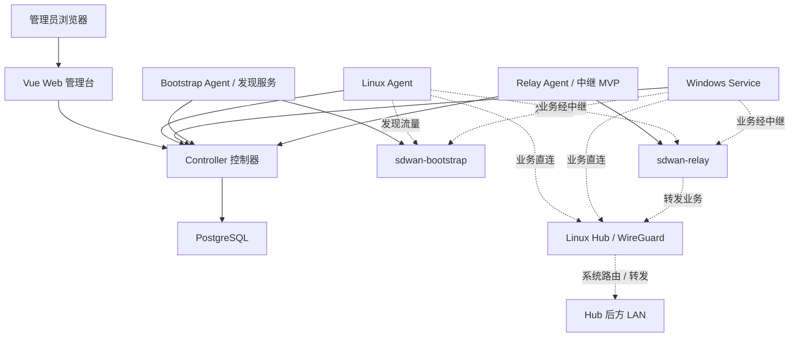

# SD-WAN 整体架构

基线：Git 标签 `v1.2.1`（提交 `2c86898`）。这是一个以 **单主站点 Hub、多个分支客户端、可选自建 Relay** 为核心的 WireGuard Overlay 系统。

## 先看职责

| 模块 | 负责什么 | 不负责什么 |
| --- | --- | --- |
| Vue 管理台 | 企业端管理账户内设备、路由、Relay；独立平台入口提供跨账户只读诊断 | 不直接写数据库，不开放平台侧企业配置写入 |
| Go Controller + PostgreSQL | 身份、设备地址、Endpoint、Netmap、路径协调；启动时执行数据库迁移 | 不转发业务流量，不直接操作宿主机 WireGuard |
| Bootstrap Agent | 把设备公钥同步到发现接口，观察真实 WireGuard UDP 源地址并上报 | 不保证 NAT 穿透，不是业务中继 |
| Relay Agent | 同步所属账户的 Peer，并上报接口、同步和握手状态 | 本身不转发包；由 Relay 宿主机 WireGuard、系统路由和防火墙执行 |
| Linux / Windows Agent | 轮询 Controller、应用 Netmap、上报路径状态 | Linux Hub 可承担 LAN 网关；Windows Service 承担终端接入，托盘是操作入口 |

服务器和客户端的完整安装步骤见 [部署手册](../deployment.md)。

## 文档划分

服务器端分为三个部分：

1. [控制器服务](server-controller.md)
2. [发现服务](server-discovery.md)
3. [中继服务](server-relay.md)

客户端分为两个部分：

1. [Linux 客户端](client-linux.md)
2. [Windows 客户端](client-windows.md)

跨模块分析：

1. [当前数据逻辑走向](data-flow.md)：注册、入网、发现、Netmap、直连/Relay、子网流量、平台差异及数据一致性。
2. [与 Tailcat 的对比及改造路线](tailcat-comparison-upgrade-plan.md)
3. [多 Hub 与安全升级路线](multi-hub-upgrade.md)

## 控制面和数据面

实线表示管理请求、状态同步或本机接口配置；虚线表示网络流量。**业务包不经过 Web、Controller、PostgreSQL 或 Bootstrap。**

## 四条关键流程

1. **入网与配置下发**：Agent 本机生成 WireGuard 密钥，使用 Admin Token 首次注册。Controller 分配账户 Overlay 内的虚拟 IP，返回独立 Device Token。之后 Agent 用它调用 `poll`；发现 Netmap 版本变化时拉取配置。Linux 优先同步现有 WireGuard 接口，Windows Service 更新 WireGuard 引擎和系统路由。
2. **发现与直连**：设备向 Bootstrap WireGuard 接口发包，Bootstrap Agent 上报观察到的真实公网 IP 和 UDP 端口。控制器通过 Netmap 分发候选 Endpoint；知道地址不代表两端在对称 NAT 或过滤 UDP 的网络里一定能直连。
3. **直连与 Relay 切换**：Controller 按客户端与 Hub 的链路维护目标路径和应用代次，Agent 上报实际应用与 Overlay 探测结果；配置应用不等于业务已验证。自动模式在后续协调中尝试切换，Relay 不健康时可回直连；强制 Relay 不自动绕回直连。Linux/Windows 也有共享的本地选路逻辑，但仍依赖成功的控制器轮询，不是断联时的独立接管。
4. **访问 Hub 后方 LAN**：Hub 发布 CIDR，管理员批准后 Controller 才下发业务路由。分支的包直达 Hub 或经 Relay 到 Hub，由 Hub 转发到 LAN；回程还需 LAN 路由或 Hub NAT。审批状态、网关自检和分支到业务服务的实际通流应分别判断。同账户重叠 CIDR 会被拒绝并记录，网关关键状态历史每条最多保留 30 条。

Relay 健康要求近期心跳、接口与 Peer 同步正常，并观察到最近 120 秒内的真实 WireGuard 握手。**一个 Peer 有握手，不代表整个账户的中继或 LAN 服务已通。** 详细状态见 [路径应用与验证](path-verification.md) 和 [中继服务](server-relay.md)。

## 部署和验证

- 基础 Compose 启动 PostgreSQL、Controller 和 Web；生产入口可由 Caddy 反代。Bootstrap、Relay 和设备 Agent 分别部署，Relay 不是必选组件。
- [Docker 实验环境](../simulation.md) 提供隔离数据库、一个 Linux Hub、两个分支及 Hub 后方 HTTP 服务。已验证直连握手、路由审批和分支到 LAN 的通流；未验证真实公网 NAT、Relay 端到端故障切换或多 Hub。
- `v1.2.1` 包含迁移 11/12，补充 Relay 健康遥测、路由历史和冲突记录。代码已打标签不等于已部署；生产步骤见 [部署手册](../deployment.md)。

## 当前产品边界

- Controller 负责身份、套餐、设备、虚拟 IP、netmap、endpoint、子网路由和 Relay 元数据。
- Linux 和 Windows 客户端负责本机 WireGuard 数据面。
- Bootstrap 发现服务通过服务端 WireGuard 观察客户端真实公网 endpoint。
- Relay 支持按客户端独立的直连优先自动 fallback；当前仍限定单主站点和单活动自建 Relay。
- 当前不是 Tailscale magicsock、DERP 或 userspace NAT traversal 的完整复刻。
- 暂无 ACL、MagicDNS、Exit Node 和生产级多 Relay 调度。
- 平台首版只有配置型只读角色；多角色权限、事件与审计、多 Hub 和 Agent 自动升级/回滚仍属于后续设计。
