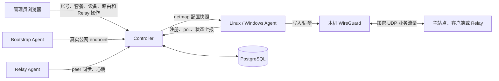
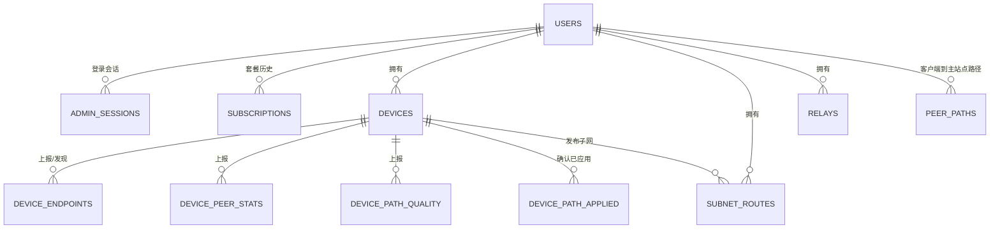
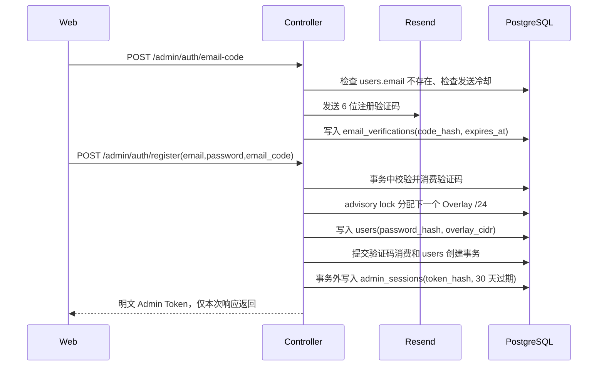
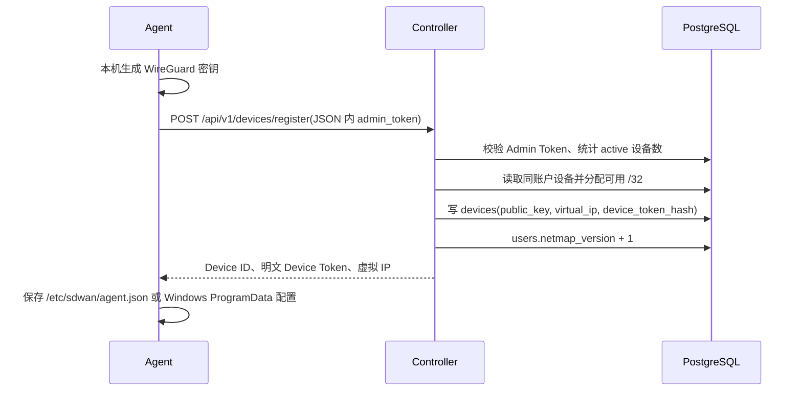
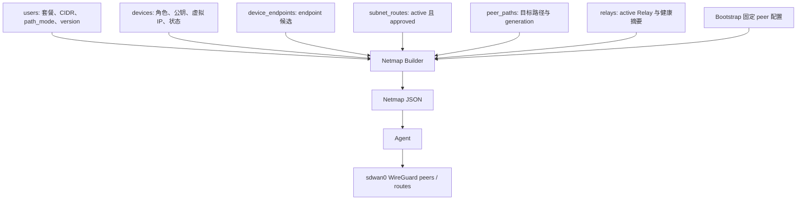
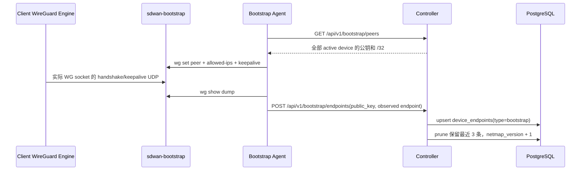
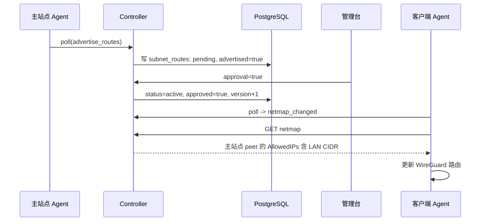
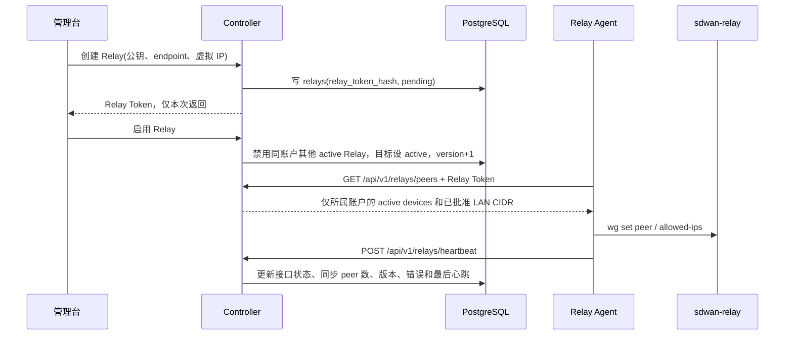
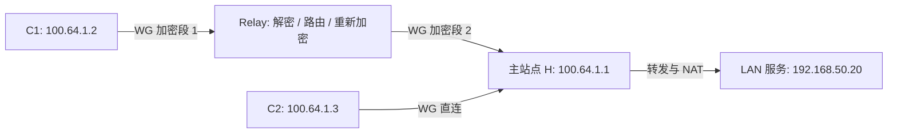

# SD-WAN 当前数据逻辑走向

版本基线：`v1.2.2`。下文保留历史实现说明；自 `v1.2.4` 起，套餐和订阅接口、能力门槛及 UI 已移除，旧表仅用于兼容和回滚。现行架构先看 [整体架构](README.md)。

本文沿代码调用关系和实际执行的 SQL，梳理数据如何产生、存储、下发和回流。分析依据是静态代码核查，本次未连接生产服务器、执行数据库迁移或进行跨主机通流测试；已确认的代码行为与需要实机验证的结果在下文分别说明。

阅读顺序：第 1～2 节看总体关系；第 3～8 节看各业务闭环；第 11～13 节看实际包、AllowedIPs 和两种客户端；第 14～17 节看时序、一致性、生命周期和优先改进项；第 18～19 节提供源码与 API 速查。

## 1. 总览：三类数据，三条闭环

系统里的数据不能只理解为“数据库数据”。实际有三类状态：

| 类别 | 保存位置 | 作用 | 典型数据 |
|---|---|---|---|
| 权威控制状态 | PostgreSQL | Controller 生成授权和配置的唯一依据 | 用户、设备、公钥、虚拟 IP、套餐、路由审批、Relay 状态 |
| 下发配置快照 | Controller API -> Agent 本地配置 | 将数据库状态转换为每台机器的 WireGuard 配置 | `netmap`、peer、公网 endpoint、`AllowedIPs`、路径策略 |
| 运行时观测状态 | WireGuard 引擎/Agent -> Controller | 提供连通性判断依据，但不等同于业务通流证明 | 握手、收发字节、LAN endpoint、Bootstrap endpoint、Relay 心跳 |



控制器本身不转发用户业务流量。它保存控制状态、接收观测数据、生成 `netmap`；Linux 客户端使用内核 WireGuard，Windows Service 使用 `wireguard-go + Wintun`。主站点和自建 Relay 再按宿主机路由、防火墙进行三层转发。

一条完整闭环是：管理员授权或 Agent 观测 -> Controller 校验 -> PostgreSQL 写入 -> Netmap 下发 -> Agent 应用 -> WireGuard 运行 -> Agent 再上报。业务数据包与这个 HTTPS 闭环并行运行。

## 2. 数据实体与归属关系



| 表 | 一行代表什么 | 谁写入 | 谁读取 |
|---|---|---|---|
| `users` | 一个账户及其 Overlay CIDR、套餐、`netmap_version`、路径模式 | 注册、套餐、路径模式接口 | 所有控制逻辑和管理台 |
| `admin_sessions` | 一个 30 天有效的管理会话 Token 的 hash | 注册/登录 | 管理台鉴权 |
| `email_verifications` | 注册邮箱验证码的 hash、有效期和尝试次数 | 邮件验证码接口 | 注册事务 |
| `plans` | 固定套餐能力与价格 | migration 初始化 | 管理台、权限判断 |
| `subscriptions` | 账户的套餐记录、来源、免费月份和到期时间 | 免费升级/取消/过期处理 | 套餐状态刷新 |
| `devices` | 一台已入网设备及其 WireGuard 公钥、虚拟 IP、角色、最后心跳 | Agent 注册、poll、管理台 | Netmap、Bootstrap、Relay |
| `device_endpoints` | 某设备可尝试的 endpoint | Agent LAN 上报、Bootstrap 观察 | Netmap 构建 |
| `subnet_routes` | 主站点发布的 LAN CIDR 及审批、网关检测结果 | 主站点 Agent、管理员审批 | Netmap、管理台 |
| `relays` | 账户自建 Relay 的公钥、Token hash、endpoint、状态与健康摘要 | 管理台、Relay Agent | Netmap、管理台 |
| `peer_paths` | 每个客户端到主站点的 Controller 路径状态机 | Controller 协调逻辑 | Path-aware Netmap、管理台 |
| `device_peer_stats` | Agent 看到的 WireGuard peer 握手和字节计数 | Agent poll | Controller 的路径健康判断 |
| `device_path_quality` | Agent 本地 direct/relay 路径质量 | Agent poll | 管理台与后续调度 |
| `device_path_applied` | Agent 已经应用的路径 generation | Agent poll | Controller 确认切换完成 |
| `audit_logs` | 设计中的审计事件 | 当前无业务写入 | 当前无实际读取路径 |

账户隔离的控制面边界是 `user_id`：每个账户拥有独立 `/24` Overlay CIDR，设备、子网、Relay 和路径状态通过该账户关联。设备层使用 `(user_id, public_key)` 和 `(user_id, virtual_ip)` 唯一约束防止同账户重复。不同账户的 LAN CIDR 可以重叠，现有校验不是全平台 LAN 地址唯一分配器。

这不代表共享宿主机已经具备完整多租户数据面隔离。尤其是 Bootstrap 汇集全平台设备，必须结合接口转发策略理解安全边界，见第 16 节。

## 3. 身份、注册与 Token 流

### 3.1 邮箱验证码与账户创建



关键规则：

- 邮箱会规范化后检查唯一性。已存在时返回“邮箱名已经注册，请更换其他邮箱”。
- 数据库不存明文密码，存 `bcrypt` hash。
- 邮件验证码也不存明文，保存 `email + purpose + code` 的 hash；消费后记录 `consumed_at`。
- `LockOverlayIPAllocator` 使用 PostgreSQL advisory transaction lock，避免两个注册事务拿到相同 `/24`。
- 注册或登录都会新建 `admin_sessions`。管理台请求将 Admin Token 放在 `Authorization: Bearer ...`，Controller 用 Token hash 查询有效会话。

当前默认验证码有效期 600 秒、发送冷却 60 秒、最大尝试数配置为 5。需要注意：错误验证码分支在注册事务中增加 `attempt_count`，随后返回错误，`WithTx` 会回滚此次增加，所以不能把配置值 5 当成已经可靠生效的错误次数限制。邮件调用在验证码落库之前，Resend 已接收而数据库写入失败时，用户也可能收到无法用于注册的验证码。

创建用户成功后才创建管理会话。如果后一步失败，用户可能已存在但前端未收到 Token，此时应区分“账户创建失败”和“会话创建失败”，不能简单重复注册。

Admin Token 同时承担当前版本的首次设备入网凭证。它适合 MVP，但比“短期、一次性、可撤销的设备 enrollment token”权限更大，这是后续需要收紧的安全边界。

### 3.2 套餐与能力数据

`plans` 是套餐定义，当前有 `free`、`subnet`、`relay`。账户的当前能力由 `users.plan_code` 表示，`subscriptions` 保存订阅来源、期限与免费升级累计月份。

```text
免费升级请求
  -> 校验目标套餐和剩余免费月份
  -> 取消现有 active subscription（或原免费订阅直接升档）
  -> 写入/更新 subscriptions
  -> 更新 users.plan_code
  -> AccountSummary 刷新过期状态后返回能力
```

当前免费升级最大累计 12 个月。`relay` 包含 `subnet` 能力，免费 `subnet` 升级为 `relay` 时保持原到期时间，只扩大能力范围。

到期刷新由 `AccountSummary`、`SubscriptionSummary`、`FreeUpgrade` 调用 `refreshSubscriptionState` 触发；当前没有独立定时到期任务。Poll/Netmap 不调用该刷新函数，`UpdateUserPlan` 本身也不提升 Netmap 版本。因此“数据库写了到期时间”不等于到期瞬间已撤销设备上的子网/Relay 能力。定价和套餐字段存在，但未发现收款、支付回调和对账闭环。

## 4. 设备入网与配置下发

### 4.1 设备注册



虚拟 IP 从用户的 Overlay `/24` 分配，跳过网络地址和广播地址。设备 Token 只在注册响应中以明文返回，数据库保存 `device_token_hash`；后续 Agent 的 `poll` 与 `netmap` 只使用 Device Token。

当前设备 IP 分配最多执行三轮尝试，仅针对 `(user_id, virtual_ip)` 唯一约束冲突重试。设备数量检查、读取已用地址、创建设备、提升 Netmap 版本不是一个完整事务。唯一约束能阻止同账户重复 IP，但不保证并发注册时严格执行设备数上限，也不保证 HTTP 失败代表“数据库没有创建设备”。

注册命令完成后仅保存身份与配置，接口真正建立发生在 daemon/service 获取并应用 Netmap 时。Windows 注册也在本机生成密钥，Admin Token 通过注册请求使用，日常运行改用 Device Token。

### 4.2 Poll：客户端向控制器的持续上报

Agent 按 Controller 返回的间隔轮询，当前 Compose 默认 5 秒。每次 `POST /api/v1/devices/poll` 会携带：

| 上报字段 | 数据来源 | Controller 写入/作用 |
|---|---|---|
| `client_version`、`os_version` | Agent 配置 | 更新 `devices.last_seen_at` 与版本信息 |
| `endpoints` | 本机网卡扫描 | 更新 `device_endpoints` 的 `lan` / `ipv6` 地址 |
| `advertise_routes` | 主站点 Agent 配置 | 创建、更新或失效 `subnet_routes` |
| `subnet_gateways` | Linux 子网网关自检 | 接收完整检查结果，落库的是启用状态、错误、出口/实际接口、LAN 目标与可达性摘要 |
| `peer_stats` | `wg show` | 更新 `device_peer_stats` |
| `path_quality` | Linux daemon / Windows Service 本地路径质量表 | 更新 `device_path_quality`；两端通过共享的路径质量和 fallback 函数上报 |
| `applied_paths` | 已应用 Netmap 的 generation | 更新 `device_path_applied` |

Controller 完成写入后读取账户的 `netmap_version`。只要客户端上报版本与账户版本不同，响应的 `netmap_changed=true`，Agent 随后 `GET /api/v1/netmap` 获取完整配置。

`netmap_version` 是一个账户级失效标记，不保存配置内容本身。设备增删、新增/裁剪 endpoint、路由审批/失效、主站点变更、Relay 启停和路径目标切换会提升它。重复地址的时间刷新、单纯心跳、路径质量上报及部分状态标记更新不提升它。具体边界见第 14 节。

Poll 内部顺序是设备心跳 -> peer stats 与 generation ACK -> 路径质量 -> endpoint -> 子网发布 -> 网关检查摘要 -> Controller 路径协调 -> 返回版本。整个 Poll 没有外层事务；后半段失败时，前半段心跳和统计可能已写入，所以“设备最近在线”不能证明该次同步完整成功。

### 4.3 Netmap：权威状态到 WireGuard 配置的转换



构建 Netmap 时：

1. Controller 先读取该账户设备，再在构建 peer 时过滤状态；endpoint 查询关联 active 设备，子网查询要求已批准、仍发布且 active。
2. 普通 Hub-and-spoke 模式下，客户端只看到主站点；主站点看到所有客户端。客户端访问主站点时，主站点虚拟 IP 和主站点已批准 LAN CIDR 同时进入该 peer 的 `AllowedIPs`。
3. `device_endpoints` 会按 `bootstrap -> manual -> lan -> ipv6 -> unknown` 排序，再按更新时间排序。正常上报后，每个设备、每种 endpoint 类型最多保留最近 3 个地址，并非每设备总共 3 个。两端客户端渲染配置时都只选排序后的第一项。
4. Bootstrap peer 是额外的固定 peer，不承载业务 `AllowedIPs`，用于让 Bootstrap 服务器观察客户端真实 WireGuard endpoint。
5. Linux daemon 根据 Netmap 渲染本地 `sdwan0` 配置；已有接口优先 `wg syncconf` 并同步系统路由，接口不存在或同步失败时调用 `wg-quick`。Windows Service 直接通过 UAPI 更新 `wireguard-go`，另行配置 Wintun 地址与系统路由。

这里的核心不变量是：同一条业务 CIDR 在某一时刻只能归属一个有效 peer 的 `AllowedIPs`。这决定了数据包通过直连还是 Relay，避免 WireGuard 路由归属不确定。

## 5. Endpoint 发现与回流

### 5.1 本地 LAN/IPv6 endpoint

Agent 扫描处于 UP 状态的网卡，排除 loopback，以及名称为 `lo` 或以 `docker`、`br-`、`veth`、`virbr` 开头的接口：

- 私有 IPv4 写成 `lan` endpoint，例如 `192.168.1.10:41641`。
- 可用公网 IPv6 写成 `ipv6` endpoint。
- 不再上报 `stun` 类型；Controller 也会忽略该类型。

这些 endpoint 提供同一局域网内的候选地址，但当前排序仍优先 Bootstrap，未实现按双方是否处于同一 LAN 优先选择局域网地址。扫描器按网卡名称排除一部分虚拟接口，并非严格只识别物理网卡。

### 5.2 Bootstrap 观察真实公网 endpoint



Bootstrap 看到的是设备实际 WireGuard socket 对这个服务器的源 IP:port；Linux 来自内核 WireGuard，Windows 来自服务内的 WireGuard 引擎。其他 Agent 在下一个 Netmap 中优先拿到该 `bootstrap` endpoint 尝试直连。

Bootstrap Agent 默认每 5 秒同步 peer、每 2 秒检查 endpoint，但只在地址与进程内 `lastEndpoints` 缓存不同时发 HTTP 上报。它当前未解析握手时间，因此非空 endpoint 不代表设备刚刚在线，数据库 `updated_at` 也不是每 2 秒刷新一次的可达性心跳。

数据库 upsert 返回的是“是否新增地址”，地址 A -> B -> 已保存的 A 时会刷新 A 的时间，但若没有裁剪记录，不一定提升 Netmap 版本。此时排序已变化，其他设备仍可能沿用旧配置。保留数量、最近观察时间、连通性和配置版本是四个不同概念。

Bootstrap 只解决“发现 endpoint”，不保证对称 NAT 下点对点一定成功。因此 Relay 仍是必要兜底。

## 6. 主站点与子网路由数据流

### 6.1 主站点角色

管理台设置主站点时，Controller 在一个事务中：

```text
清空旧 main_site
  -> 将目标设备设为 main_site
  -> 禁用其他设备发布的子网路由
  -> netmap_version + 1
```

数据库索引保证一个账户最多只有一个 active `main_site`。普通客户端只与主站点建立业务可达路径，主站点扮演 Hub。

### 6.2 子网发布、审批和生效



正常发布、审批和下发流程涉及以下检查，检查发生在不同阶段：

- 发布者是当前主站点。
- 账户套餐具备子网能力。
- 路由不和该账户已有路由冲突。
- 管理员已批准。
- 路由仍处于 advertised 且 active 状态。

Linux 主站点通过 `subnet-gateway enable` 设置转发/NAT，并把 CIDR 和网关检查参数保存在本机配置。daemon 对已保存的网关执行检查，上报 `ip_forward`、iptables NAT/FORWARD 规则、WireGuard 接口、出口接口、到 LAN 目标的路由及 ping 可达性；Controller 只把摘要字段写回 `subnet_routes`。网关 `enabled` 的计算不要求 ping 成功，LAN ping 结果单独返回，避免把禁 ICMP 等同于不能转发。

注意：套餐能力主要在发布、审批阶段检查，Netmap 查询本身没有重新按订阅到期计算权限；它筛选的是 `status=active AND advertised=true AND approved=true`。网关状态主要是可观测性数据，也不会因为某次网关自检失败自动撤销已批准路由。

子网上报还需注意：`advertise_routes=null` 或字段缺失表示跳过同步，显式 `[]` 才会撤回全部发布；本地配置字段使用 `omitempty`，删除最后一条路由后仍应验证最终请求确实为 `[]`。管理员“停用”现在同时撤回发布并清除审批；Hub 再次发布后路由保持 pending，必须由管理员重新审批。

## 7. Relay 与路径状态数据流

### 7.1 自建 Relay 注册和同步



Relay Token 与 Device/Admin Token 分离，数据库仅保存 hash。Relay Agent 使用 Token 后，只能拉取其所属账户的 peer 集合；它拿到的主站点 peer 会额外带上已批准 LAN CIDR，以便 Relay 将子网流量转给主站点。

创建后的 `pending` Relay 不能拉取 peers，必须先激活节点；激活节点与把账户模式改成 `auto/relay` 是两个操作。当前共享 WGManager 只执行 `wg set`，不自动安装 Relay 宿主机的 LAN/Overlay 系统路由、开启 forwarding 或设置 FORWARD 规则。Relay 侧不预先配置设备 endpoint，由客户端主动联系 Relay 后学习。

Relay 健康现拆为控制面与数据面：心跳/接口/Peer 同步成功，且最近 120 秒至少观察到一个真实 WireGuard Peer 握手，才进入 `healthy`。`offline`、`degraded`、`awaiting_data_plane` 会在账号接口分别呈现。Direct 模式将 Relay 作为无业务 AllowedIPs 的探测 Peer 下发；`auto` 在 Relay 故障时回退 direct，`relay` 强制模式 fail-closed。握手仍只是 Relay 可响应的证据，具体客户端到 Hub/LAN 的业务验证由 Agent 路径验证补充。

### 7.2 Controller 路径状态机

`users.path_mode` 有三种模式：

| 模式 | Controller 下发意图 | Agent 业务路径 |
|---|---|---|
| `direct` | 直连 peer 持有业务 `AllowedIPs` | 强制直连 |
| `auto` | 同时下发 direct 和 Relay 候选 | 直连优先，失败后可切 Relay |
| `relay` | Relay 持有业务 `AllowedIPs` | 强制经 Relay |

表中描述模式的目标意图。实际下发还取决于 `peer_paths.desired_path` 和活动 Relay 是否存在；模式变化需要后续 Poll 推进，path-aware 分支在找不到活动 Relay 时会把路由放回 direct peer，不能把模式字段本身当作实时路径。

Controller 为每一个“客户端 -> 主站点”维护一条 `peer_paths`。它会从双方 Agent 上报的 `device_peer_stats` 判断最近握手是否健康，然后推进：

```text
direct
  -> direct_suspect
  -> preparing_relay (generation + 1)
  -> relay
  -> direct_recovering
  -> preparing_direct (generation + 1)
  -> direct
```

一次切换不是 Controller 直接认定完成，而是：

1. Controller 写入新的 desired path 和 generation，并提升 `netmap_version`。
2. 客户端与主站点分别拉取 Netmap、应用 WireGuard 配置。
3. 两端在后续 poll 的 `applied_paths` 上报已应用 generation。
4. Controller 只有看到双方 generation 均已达到要求，才把 `current_path` 更新为 `desired_path`。

这是 Controller 协调切换的应用确认机制，不是业务通流确认。ACK 只携带 `client_device_id + generation`，没有实际选择的路径或探测结果；初次创建 `peer_paths` 时还会直接把 current/desired 初始化为同一值，并不经过两端确认。不能把表中的 `current_path` 当作已经验证的实际转发路径。

协调动作在设备 Poll 内触发，没有独立状态机定时器。`pairHandshakeHealthy` 只检查两端握手是否都在最近 30 秒内，当前未使用已存储的 `last_rx_at` 或接收计数。先判握手过旧，再等 `direct_suspect` 持续 30 秒，因此实际切换耗时不固定为“断网 30 秒”；还受轮询、应用和 ACK 延迟影响。

### 7.3 Agent 本地快速 fallback

Linux daemon 和 Windows Service 共用 `ApplyLocalPathFallback`。两端保存 `last_netmap` 和 `path_qualities`，每轮从 WireGuard peer stats 更新本地判断，代码意图是：

- 直连当前路径无近期握手/收包且失败次数至少为 2 时，把业务 `AllowedIPs` 从 direct peer 移到 Relay peer；刷新失败次数采用 45 秒窗口，选路使用 30 秒窗口。
- Relay 至少驻留 60 秒。
- 直连恢复并稳定 30 秒后，再把业务 `AllowedIPs` 移回 direct peer。
- 非当前路径仍保留 peer 和 endpoint，并通过较短 keepalive 继续观测。

本地切换会重新渲染并应用配置，不必等待 Controller 再提升一次 Netmap 版本。但执行位置在 `client.Poll` 成功之后；Poll 失败直接退出该轮，本地执行器不会继续运行。因此目前还不具备 Controller 断联期间独立快速切换的能力。

本地切换只选择近期有 WireGuard 握手/收包证据的 Relay peer；Relay 未验证时不从直连切入。fallback 为 peer slice 创建副本，并在 Hub 侧恢复路径时只把各 Client 自己的 Overlay `/32` 放回对应 Peer，避免用聚合 Relay 路由污染单条路径。

本地结果通过下一轮 Poll 回流；`local_reason`、`healthy_since` 和 `switched_at` 留在本地，尚未包含在质量上报 JSON 中。Controller 接收质量表用于账户聚合，但其状态机仍读取 `device_peer_stats`，没有直接消费 Linux 的本地路径选择。详见第 17 节。

当前限制是单主站点、单活动自建 Relay；`relay_candidates` 字段已存在，但实际只下发一个候选。

## 8. 管理台读取链路

管理台不直接访问 PostgreSQL。Vue Web 通过 `/admin/*` 调用 Controller，携带 Admin Token。`GET /admin/account` 是主要聚合接口，会返回：

```text
users 当前套餐/Overlay/路径模式
+ active device 数与主站点
+ plans 与 subscription/free upgrade 摘要
+ subnet_routes 及网关检测字段
+ relays 及心跳、接口、同步摘要
+ peer_paths 与 device_path_quality
=> 管理台账户总览
```

账户聚合接口已经返回上述数据，但 Web 当前主要渲染 `peer_paths` 和 `relay_healthy`，未消费 `account.path_quality`，也没有完整路径时间线。`loadDashboard` 在初次打开、登录和用户操作后触发，未发现后台定时刷新或 WebSocket/SSE；页面停留时不会自动跟随心跳更新。

子网路由当前按同一企业账户验证 Overlay 冲突和 LAN CIDR 重叠。检测到重叠时，Controller 拒绝该次路由更新，并将冲突 CIDR、发布设备和冲突对象写入事件记录；有效配置恢复后，事件标记 resolved。每条路由保留最近 30 次状态/网关健康变化，管理台给出出口接口、转发/NAT、LAN 可达性和 TCP 服务探测建议。不同租户可以使用相同 RFC1918 CIDR，因为其 Overlay 和策略边界彼此隔离。

## 9. 数据安全与保留策略

| 数据 | 存储方式 | 当前保留策略 |
|---|---|---|
| 密码 | bcrypt hash | 随用户保留 |
| Admin/Device/Relay Token | SHA-256 hash | 明文只在创建响应中返回 |
| WireGuard 私钥 | Agent 本机配置文件 | 不上传 Controller；需依赖主机文件权限 |
| WireGuard 公钥 | `devices` / `relays` | 随设备或 Relay 保留 |
| 邮箱验证码 | hash + 过期时间 | 消费后标记，当前未见定期清理任务 |
| endpoint | 地址、来源、时间 | 每设备、每 endpoint 类型保留最近 3 条 |
| peer/path 统计 | 最新状态覆盖写 | 不保留完整历史序列 |
| 审计日志 | 表已存在 | 当前业务代码未写入，因此没有实际审计闭环 |

## 10. 当前数据逻辑的重点风险与改进方向

1. 设备 IP 分配虽然有唯一约束和重试，但尚非完整的用户级串行分配事务；高并发注册时可能出现重试失败。
2. `netmap_version` 是粗粒度账户级失效标记。endpoint 频繁变化会让同账户全部 Agent 拉取完整 Netmap，设备量增加后需要评估增量分发或事件推送。
3. endpoint 只按最近 3 条保留，没有 TTL。设备换网后旧公网 endpoint 可能长期停留在候选列表中。
4. `device_peer_stats` 和 `device_path_quality` 是覆盖式快照，当前分别用于路径判断和质量聚合，不足以做长期 SLA、问题回放和 Relay 容量规划；选路仍有第 17 节列出的闭环缺口。
5. 网关自检失败不会自动关闭已批准子网路由。后续可引入“路由可用性”状态，但要区分配置审批与运行健康，避免瞬时 ping 波动造成路由震荡。
6. Relay 的心跳、接口状态和同步错误已经入库，但各判断分支使用的健康条件不一致，也没有多 Relay 实际选择机制。
7. `audit_logs` 尚未接入关键写操作。注册、设备删除、主站点变更、路由审批、Relay 启停、套餐变更应产生审计事件。
8. Admin Token 兼作首次设备注册凭证，权限范围偏大。后续应改为短期、一次性、可撤销的 enrollment token。

## 11. 一条完整业务包的走向

以客户端访问主站点 LAN `192.168.1.0/24` 为例：

```text
主站点发布并获批 192.168.1.0/24
  -> Controller 将该 CIDR 写入客户端 Netmap
  -> Agent 将 CIDR 写入当前业务 peer 的 AllowedIPs
  -> 应用程序发往 192.168.1.x 的包进入 sdwan0
  -> direct 时：客户端 WireGuard -> 主站点 WireGuard
  -> relay 时：客户端 WireGuard -> sdwan-relay -> 主站点 WireGuard
  -> 主站点开启 ip_forward、FORWARD 与必要 MASQUERADE
  -> LAN 主机响应沿反向路径返回
```

对应的控制数据、配置数据和业务数据始终是三条不同的流：

- 控制数据：HTTPS API，负责身份、状态与 Netmap。
- 配置数据：Netmap 被 Agent 转为本机 WireGuard peer 与路由。
- 业务数据：WireGuard UDP 加密包，Controller 不在其转发路径上。

第 12 节继续把这条链路细化到每一端的 AllowedIPs、系统路由、加密边界与返回路径。

## 12. 业务数据包与 AllowedIPs 的逐跳对应

以下地址仅用于解释，不表示当前服务器实测配置：账户 Overlay `100.64.1.0/24`，主站点 H 为 `100.64.1.1`，客户端 C1 为 `100.64.1.2`、C2 为 `100.64.1.3`；H 的 LAN 为 `192.168.50.0/24`，LAN 地址为 `192.168.50.1`，目标服务为 `192.168.50.20:443`。

### 12.1 先区分四种地址或路由

| 概念 | 示例 | 在哪里生效 |
|---|---|---|
| 虚拟 IP | C1 的 `100.64.1.2/32` | 本机虚拟接口地址、内层 IP 包 |
| Endpoint | 对端公网 IP 和 UDP 端口 | WireGuard 外层 UDP 发到哪里 |
| 系统路由 | `192.168.50.0/24 dev sdwan0` | 操作系统决定包进入哪个接口 |
| peer 的 AllowedIPs | H peer 的 `100.64.1.1/32, 192.168.50.0/24` | WireGuard 发包时选哪个 peer，收包时允许该 peer 使用哪些源 IP |

收到 Endpoint 只补齐了其中一项。系统路由、AllowedIPs、握手及目标服务必须同时成立。WireGuard 的收发地址校验和 endpoint roaming 语义见[官方 Cryptokey Routing 说明](https://www.wireguard.com/#cryptokey-routing)。

### 12.2 正常直连时

| 所在设备 | peer | 业务 AllowedIPs |
|---|---|---|
| C1 | H | `100.64.1.1/32, 192.168.50.0/24` |
| H | C1 | `100.64.1.2/32` |
| H | C2 | `100.64.1.3/32` |
| C1、H（auto 模式） | Relay | 空，保留 peer/endpoint/keepalive |
| 各 Agent | Bootstrap | `100.254.254.254/32`，独立的观察路径 |

```text
C1 应用程序产生包：100.64.1.2 -> 192.168.50.20:443
  -> C1 系统路由匹配 LAN CIDR，进入 sdwan0/Wintun
  -> WireGuard 按目标地址选择 H 的公钥
  -> UDP 加密包发到 H 的 endpoint
  -> H 验证 C1 身份及内层源地址 100.64.1.2
  -> H 的系统路由/FORWARD 把内层包送往 LAN
  -> 使用当前 subnet-gateway NAT 模式时，源地址变为 H 的 LAN 地址
  -> LAN 服务收到请求
```

LAN 回复先发回 H 的 LAN 地址，conntrack 还原目标为 `100.64.1.2`；H 根据系统路由进入 WireGuard，再由 C1 peer 的 `/32` 将回复送回 C1。NAT 使 LAN 主机通常无需额外配置 Overlay 回程路由。若使用手工路由方式替代 NAT，则必须在 LAN 侧提供回到 Overlay 的路由。

### 12.3 C1 切 Relay、C2 保持直连时

下面是 Controller 对单条链路完成协调后的目标配置，不代表 Linux 本地执行器在多客户端情形下已经完全满足这个不变量。

| 所在设备 | peer | 业务 AllowedIPs |
|---|---|---|
| C1 | H 的 direct peer | 空 |
| C1 | Relay | `100.64.1.1/32, 192.168.50.0/24` |
| H | C1 的 direct peer | 空 |
| H | C2 的 direct peer | `100.64.1.3/32` |
| H | Relay | `100.64.1.2/32` |
| Relay | H | `100.64.1.1/32, 192.168.50.0/24` |
| Relay | C1 | `100.64.1.2/32` |
| Relay | C2 | `100.64.1.3/32`，已同步但不代表 C2 正在走 Relay |



当前自建 Relay 是三层 WireGuard Hub。客户端与 Relay、Relay 与主站点分别建立加密会话，Relay 主机可以看到解封装后的内层 IP 包；应用自身的 HTTPS/TLS 加密仍然有效。这一性质来自当前“把 Relay 公钥配置为业务 peer”的实现，不能把它描述成只转发端到端 WireGuard 密文的 DERP。

Relay 上仅有 peer AllowedIPs 还不够：宿主机到 Overlay 和 LAN 的系统路由需要指向 `sdwan-relay`，并允许该接口进出转发。若与 Bootstrap 同机，Overlay 的更具体路由应覆盖 Bootstrap 的宽网段路由；LAN 路由也需要单独覆盖。当前 Relay Agent 不负责创建这些系统路由。

### 12.4 为什么不能只切一端

假设 C1 已把 H 的地址交给 Relay，而 H 仍只允许 direct peer 使用源地址 `100.64.1.2`。即使 Relay 到 H 的握手正常，从 Relay peer 解密出来的 C1 源地址也可能被 H 的 AllowedIPs 源地址校验拒绝。回程的 peer 选择还可能与去程不同。

因此切换同时影响发包方向与收包授权。两端 generation ACK 是协调基础，仍需补充实际路径确认和通流验证；独立本地切换需要明确处理两端短暂不同步的状态。

### 12.5 客户端之间并不默认全网互通

当前主路径是客户端与主站点配对，C1 的常规 Netmap 没有 C2 的 `/32`，也不会自动包含账户整个 `/24`。所以“Hub 拓扑”不意味着客户端之间已经能自动互访。

`Netmap` 中保留了旧 `relay_mode` 兼容分支，该分支可把整个账户 `/24` 指向 Relay；它出现在 `pathAwareNetmap` 未处理请求之后。分析现版本应优先看 path-aware 分支，不能用旧分支推断所有强制 Relay 场景都放开客户端之间互通。

## 13. Linux 与 Windows 的实际执行链路

| 项目 | Linux `cmd/agent` daemon | Windows `cmd/windows-service` |
|---|---|---|
| 网络引擎 | 内核 WireGuard | 进程内 `wireguard-go` 加 Wintun |
| 身份配置 | `/etc/sdwan/agent.json` | `%ProgramData%\sdwan\agent.json` |
| Netmap 应用 | 写 `.conf`，再 `wg syncconf`/`wg-quick` | `renderUAPI -> IpcSet -> 配置系统地址/路由 -> dev.Up` |
| 观测来源 | `wg show ... dump` | `IpcGet -> ParseUAPIStats` |
| Controller generation ACK | 有 | 有 |
| 本地质量刷新/上报 | 有 | Service 主循环没有接入 |
| 本地 `ApplyLocalPathFallback` | 有 | Service 主循环没有调用 |
| 子网网关自检上报 | 有，针对本地已保存配置 | Service 未上报 `subnet_gateways` |
| Poll 间隔 | 成功后采用 Controller 返回值，默认 5 秒 | `nextInterval` 固定返回 5 秒 |
| 一轮失败 | 日志后 15 秒再尝试 | 日志后 15 秒再尝试 |

Windows Tray 的作用是提供注册、服务启停和状态入口，实际组网运行在 Windows Service。共用 `internal/agent` 中的 API 类型，不代表共用 daemon 主循环，也不代表两个客户端功能自动同步完成。已有 userspace WireGuard 引擎也不等同于已有 magicsock 或完整 NAT 打洞器。

Linux 的一轮时序更精确地表示为：

```text
重新读 agent.json
  -> 扫描本地 endpoint、读取 WG stats、刷新本地质量、检查网关
  -> Poll 上报“本轮切换前”的质量与上一轮应用 generation
  -> Poll 失败：返回错误，等待 15 秒；本轮不执行本地选路
  -> Poll 成功且版本未变：用缓存 Netmap 做本地选路
  -> 首轮或版本改变：拉 Netmap，再做本地选路
  -> 写 WireGuard 配置、应用 peer、同步系统路由
  -> 保存 netmap_version、applied_paths、last_routes、本地质量
  -> 下一轮 Poll 才上报本轮结果
```

本地文件使用 `os.WriteFile` 直接写入，并非临时文件加原子 rename。应用 WireGuard、更新系统路由、保存 JSON 也不是一个原子事务；中间失败时应分别检查“内存/磁盘/内核”三处状态。

## 14. 版本、时间与数据新鲜度

### 14.1 `netmap_version` 与 `generation` 分工

`users.netmap_version` 作用于整个账户，告诉设备需要重新获取配置；`peer_paths.generation` 作用于某个客户端与主站点的路径配对，告诉两端需要确认哪次切换。Netmap 的 `path_generation` 是相关路径代次的汇总，ACK 使用 `path_assignments` 中每条配对自己的 generation。

| 事件 | 数据变化 | 是否提升 Netmap 版本 |
|---|---|---|
| 注册/删除设备 | `devices`，删除时外键关联记录级联清理 | 是，但设备写入与版本提升分开执行 |
| 设置主站点 | 设备角色、其他设备路由失效 | 是，同一个事务 |
| 新 endpoint 或裁剪旧记录 | `device_endpoints` | 是 |
| 已有 endpoint 再上报 | 更新时间、source、RTT | 通常否，即使更新时间影响排序 |
| 子网审批、禁用或发布集合变化 | `subnet_routes` | 是 |
| 网关检查摘要发生变化 | `subnet_routes.gateway_*` | 是；状态不变时连 checked_at 也不刷新 |
| 创建 pending Relay | `relays` | 否 |
| 启停 Relay、设置路径模式 | Relay/账户/路径元数据 | 是 |
| Relay 心跳或同步错误 | `last_seen_at/interface_up/last_error` 等 | 否 |
| Controller 设置新 desired path 或完成 ACK | `peer_paths` | Poll 根据 changed 结果提升版本 |
| 仅标记 suspect/recovering | `peer_paths.state/updated_at` | 当前不返回 changed，不一定触发下发 |
| peer stats、path quality、应用 ACK 上报 | 三张运行状态表 | 单独写入不提升；ACK 后续可能促成路径完成 |
| 套餐升档/取消/到期 | `subscriptions/users.plan_code` | 当前这些路径没有相应版本提升 |
| Linux 本地选路 | 本机质量、peer AllowedIPs、文件 | 不提升 Controller 版本 |

Netmap 由多个普通数据库读取组装，未采用单个一致性快照事务。并发配置变更期间不能假定响应中的所有字段与一个不可变版本严格绑定，当前主要依靠后续 Poll 收敛。

### 14.2 定时参数不等于恢复时间保证

| 项目 | 当前默认/代码条件 | 含义 |
|---|---|---|
| Linux Poll | 5 秒，可由 Controller 配置返回 | 一轮结束后等待该间隔，实际周期还含 HTTP/检查耗时 |
| Windows Poll | 成功后 5 秒 | 当前未使用响应中的动态间隔 |
| Bootstrap peer 同步 | 5 秒 | 注册成功后还需等待同步才能接受新设备 |
| Bootstrap endpoint 检查 | 2 秒 | 仅变化上报，不是定时重新证明可达 |
| Relay peer 同步/成功心跳 | 5 秒 | 同步失败可上报错误心跳 |
| Relay 心跳窗口 | 15 秒 | HTTP Agent 活跃判断，不证明转发链可用 |
| Controller 直连握手窗口 | 30 秒 | 两端均须满足；超窗后才开始 suspect 等待 |
| Controller suspect 等待 | 30 秒 | 之后还需拉配置、应用和 ACK |
| Relay 驻留/恢复观察 | 60 秒/30 秒 | Controller 和 Linux 本地各有判断逻辑 |
| 非当前路径 keepalive | 10 秒；当前路径通常 25 秒 | 保留通信尝试，不是独立 RTT/业务探测 |

WireGuard 握手用于建立/更新会话密钥，正常数据包和 keepalive 不保证每次都刷新握手时间。因此“30 秒没有新握手”不能单独等价为路径断开；目前 Controller 已保存收包时间但没有把它纳入此判断。[WireGuard 协议说明](https://www.wireguard.com/protocol/)

### 14.3 几种时间戳不能混用

- `devices.last_seen_at`：Controller 收到并处理设备心跳的时间，不代表最近业务收包。
- `device_peer_stats.reported_at`：Controller 收到统计的时间；`latest_handshake_at` 是客户端提供的握手时间。
- `last_rx_at`：轮询观察到累计接收字节增长的近似时间，不是逐包硬件时间戳。
- Bootstrap endpoint 的 `updated_at`：地址上报入库时间；不变时可能长时间不刷新。
- `relays.last_sync_at`：最近一次 `sync_ok=true`；`last_seen_at` 则包括失败心跳。
- 网关 `gateway_checked_at`：目前 SQL 只在摘要变化时更新，不能据此判断 Agent 是否每轮都在检查。

这些字段混有服务器时间和客户端时间，部署时需要保证时钟同步。接收计数增长也可能只是 keepalive，不代表 LAN 服务健康。

## 15. 事务与失败后的数据去向

| 操作 | 已有原子范围 | 需要理解的失败边界 |
|---|---|---|
| 注册账户 | 验证码消费、CIDR 锁、用户写入 | 会话创建在提交之后；验证码错误次数增加随错误回滚 |
| 发验证码 | 单独邮件调用、单独 DB 写入 | 邮件成功和落库成功可能不一致，冷却检查也未串行化 |
| 注册设备 | 每次 INSERT 和唯一约束 | 数量检查、地址选择、插入和版本 bump 分开；无幂等注册请求 ID |
| Poll | 多个独立更新 | 可能部分成功；后续错误不能撤销先前心跳/统计 |
| 切换主站点 | 角色、旧路由失效、版本 bump | 各 Agent 仍要等 Poll 才应用 |
| 启停 Relay | Relay 状态、禁用时账户模式、版本 bump | 已存在的宿主机 peer 不由此操作直接删除 |
| 设置 path mode | 模式更新、ensure paths、版本 bump 分开 | 模式已更新但后续失败时可能暂时未下发 |
| 免费升级 | 订阅变更与用户 plan 写入 | 免费月份检查在事务外，缺少并发领取串行控制 |
| Agent 应用 | 文件、WG、系统路由、JSON 分步 | 一步失败后可能留下部分配置；应用 ACK 不是通流 ACK |

数据库事务只能保证 Controller 内的相关数据写入，不能跨越 HTTP、操作系统路由和 WireGuard。后续可靠性改造应让各阶段可重试、可确认，同时区分配置版本、实际应用路径和业务探测结果。

## 16. 删除、撤销与隔离的数据闭环

### 16.1 删除设备

```text
管理员 DELETE 设备
  -> 校验设备 user_id
  -> DELETE devices，级联清理 endpoint、路由、相关路径等外键记录
  -> 账户 netmap_version + 1
  -> 其他 Agent 下一次同步移除该 peer
  -> 被删设备的 Device Token 后续查询失败
```

HTTP Token 失效不会擦除客户端本地 WireGuard 密钥；但设备从 Controller 的活动清单移除后，Bootstrap/Relay Agent 会在下一轮同步（默认 5 秒）删除不再期望的 Peer。撤销生效仍受同步 API 可用性和现存连接刷新时间影响，不应表述为数据库删除瞬时切断所有流量。

`device_peer_stats.peer_public_key` 和 `device_path_quality.peer_device_id` 不是指向被观测对端的外键；删除观察者会清理其行，删除对端却可能留下其他设备保存的历史引用。它们是最新观测缓存，不是完整的设备关系权威表。

### 16.2 Token 与密钥分属两套身份

| 凭证 | 使用者与去向 | 持久化位置 |
|---|---|---|
| Admin Token | 浏览器 `/admin/*`；注册设备时放 JSON `admin_token` | 浏览器 localStorage 存明文，DB 存 hash/有效期 |
| Device Token | 设备 Poll/Netmap 的 Bearer | 本机 agent.json 存明文，DB 存 hash；未见独立到期字段 |
| Bootstrap Token | 发现 Agent 访问全平台 bootstrap API | Controller 环境与发现 Agent 配置，直接比对 |
| Relay Token | 自建 Relay 同步所属账户 peer/心跳 | Relay 本机配置存明文，DB 存 hash |
| WireGuard 私钥 | 本机 WireGuard 身份和密钥协商 | 设备或 Relay 宿主机，不发送给 Controller |
| Resend API Key | Controller 请求邮件服务 | 服务端环境配置，不下发 Agent/Web |

Web 退出登录目前清除本地会话状态，未见撤销服务器 Admin Session 的 logout API。因此“本地退出”和“服务器会话被撤销”也要区分。

### 16.3 共享发现节点的边界

Bootstrap 使用一个 WG 接口承载全平台 active 设备，Controller 按设备公钥回查设备，数据库却只保证公钥在同账户内唯一。两个账户误用同一设备密钥时，Bootstrap peer map 会以公钥合并，回查又选最新创建的设备，可能造成地址归属和 endpoint 上报错配。共享发现节点要求公钥身份在其服务范围内无歧义。

数据库 `user_id` 过滤与独立 `/24` 解决控制数据归属，不自动提供宿主机防火墙。特别是 Bootstrap 与 Relay 同机开启 `ip_forward` 时，应明确限制 Bootstrap 的跨 peer 转发；当前发现程序没有安装这类账户级 ACL。多账户 LAN 地址重叠的问题也不能靠在同一个共享路由表里添加两条相同 CIDR 解决。

## 17. 已确认的数据闭环缺口与改进优先级

下面的“已确认”表示代码中存在对应调用或缺失判断，并不表示本次已在客户现场复现。

| 优先级 | 缺口与代码依据 | 对数据逻辑的影响 | 建议方向 |
|---|---|---|---|
| P0 | 两端本地逻辑仍在成功 Poll 之后运行 | Controller API 完全不可达时不会独立切换 | 继续把路径评估与控制同步解耦，并增加本地持续运行/恢复测试 |
| P0 | Relay 的 Controller 心跳和 Agent 本地 WireGuard 握手是不同健康信号 | 本地切换要求 Relay 有近期 WireGuard 握手，但尚无业务端到端探测 | 区分进程、接口、同步、握手和端到端业务探测 |
| P0 | generation ACK 没有实际路径；本地选择可能覆盖 Controller desired | Controller 可能把代次确认误读为目标路径已经运行 | 上报 applied path、代次、结果与来源，明确两端协调规则 |
| P0 | fallback 需从 Relay 聚合 AllowedIPs 推导原始业务路由 | Hub 多客户端回切时必须避免不同 client 路由集合串用 | 已按 Hub/client 角色区分 Overlay 路由，并避免写坏缓存快照；LAN CIDR 变化仍需覆盖测试 |
| P0 | 套餐到期惰性刷新、plan 更新不 bump 版本、Netmap 子网筛选不以实时到期为准 | 到期/取消与已下发权限不完全联动 | 统一有效能力计算，事务撤回能力并提升版本 |
| P1 | 首选 endpoint 单选、旧地址无失效机制、回到已有地址不一定 bump 版本 | 数据库候选更新不等于客户端实际换 endpoint | 定义 observed/valid 时间与候选切换策略，按有效排序变动触发更新 |
| P1 | 最后一条路由删除仍需验证显式空数组的序列化语义 | Agent 撤回与跳过同步不可混淆 | 增加端到端 API 测试覆盖 `[]` |
| P1 | 设备删除要等待 Bootstrap/Relay 下一次同步 | 数据库撤销与 Peer 移除有数秒窗口 | 两个 Agent 现在每轮都清理不在 Controller 清单中的 Peer；需验证实际主机同步 |
| P1 | 注册验证码错误计数回滚；注册/套餐检查缺少并发串行边界 | 错误限制和配额检查可能与预期不同 | 调整计数事务边界、并发控制和重试幂等性 |
| P1 | Web 未展示 path_quality、无自动刷新，子网行误用 relay 变量 | 后端已收集的数据未形成可靠页面反馈 | 修复作用域绑定，显示观测时间和实际应用路径 |

本轮已实现 readiness 数据库探测、管理员停用子网必须重新审批、Bootstrap/Relay 自动清理 stale Peer，以及 Windows 本地路径 fallback 接入和 Relay 握手门控。其余表项仍是待完成项；代码修改不等于已部署到生产。

## 18. 源码导航与核查入口

| 数据链路 | 主要入口与函数 |
|---|---|
| 启动、数据库连接与 migration | [Controller main](../../cmd/controller/main.go)、[Store.Migrate/WithTx](../../internal/storage/storage.go) |
| 对外 API 与鉴权调用 | [HTTP Router](../../internal/httpapi/router.go) |
| 注册、套餐、设备、Poll、Netmap、Relay/Bootstrap API | [Service](../../internal/app/service.go)：`RegisterAdmin`、`RegisterDevice`、`Poll`、`Netmap`、`RelayPeers`、`ReportBootstrapEndpoint` |
| Controller 路径策略/协调 | [path.go](../../internal/app/path.go)：`SetPathMode`、`reconcilePeerPaths`、`pathAwareNetmap` |
| 运行时 SQL、版本和生命周期 | [queries.go](../../internal/storage/sqlc/queries.go)、[path_queries.go](../../internal/storage/sqlc/path_queries.go) |
| 表结构及演进 | [migration 目录](../../db/migrations)：初始化、角色、订阅、邮件验证码、路径、网关、Relay 健康/质量 |
| Linux 一轮同步与本地选路 | [daemon.go](../../internal/agent/daemon.go)、[path_quality.go](../../internal/agent/path_quality.go) |
| Linux 配置与系统路由 | [wireguard.go](../../internal/agent/wireguard.go)、[apply_linux.go](../../internal/agent/apply_linux.go)、[apply.go](../../internal/agent/apply.go) |
| 网卡地址候选与配置保存 | [endpoint.go](../../internal/agent/endpoint.go)、[config.go](../../internal/agent/config.go) |
| 子网发布命令与网关操作 | [Agent CLI](../../cmd/agent/main.go)、[subnet_gateway_linux.go](../../internal/agent/subnet_gateway_linux.go) |
| Windows 网络数据面 | [Windows Service](../../cmd/windows-service/main.go)：`RunOnce`、`applyNetmap`、`renderUAPI` |
| Windows 用户入口 | [Windows Tray](../../cmd/windows-tray/main.go) |
| Bootstrap 发现回流 | [Bootstrap Runner](../../internal/bootstrapagent/runner.go)、[WGManager](../../internal/bootstrapagent/wg.go) |
| Relay peer 同步与心跳 | [Relay Runner](../../internal/relayagent/runner.go)、[Relay API Client](../../internal/relayagent/api.go) |
| 管理台请求和数据渲染 | [App.vue](../../web/src/App.vue)：`loadDashboard`、路径列表和子网列表 |
| 环境参数与入口代理 | [config.go](../../internal/config/config.go)、[Compose](../../docker-compose.yml)、[Caddyfile](../../deploy/caddy/Caddyfile) |

Controller 启动会先连接数据库并执行嵌入的版本化 migration，再监听 HTTP。当前工作区新增的 `000008` 为 Relay 健康与路径质量字段提供结构，部署新二进制前必须让数据库结构与代码匹配；本文未执行这些迁移。

诊断时可沿“身份存在 -> API 已接受 -> DB 已变更 -> 版本已通知 -> 客户端已拉取 -> 配置已应用 -> 双向握手/收包 -> LAN 服务响应”逐级定位。`/healthz` 表示进程存活；`/readyz` 会 Ping PostgreSQL，但不探测 Relay 或 Overlay 业务链路。

## 19. API 数据方向速查

下表对应当前 Router 注册的接口。管理员和设备控制请求走 HTTP API，生产入口通过 HTTPS；Bootstrap/Relay 的 WireGuard UDP 与这些 API 是独立端口和协议。

| 调用方向 | 接口 | 凭证/输入 | 返回或主要副作用 |
|---|---|---|---|
| Web -> Controller | `POST /admin/auth/email-code` | email、purpose，无 Token | 发送验证码并存 hash |
| Web -> Controller | `POST /admin/auth/register`、`POST /admin/auth/login` | 邮箱、密码；注册加验证码 | 用户摘要、Admin Token、会话过期时间 |
| Web -> Controller | `GET /admin/auth/me`、`GET /admin/account` | Admin Bearer | 用户、套餐、设备/Relay/路由/路径聚合；account 可触发到期刷新 |
| Web -> Controller | `GET /admin/plans` | 当前 Router 未校验 Token | 套餐定义 |
| Web -> Controller | `GET /admin/subscription`、`POST /admin/subscription/free-upgrade`、`POST /admin/subscription/cancel` | Admin Bearer，目标套餐/月数 | 订阅及用户 plan 变化 |
| Web -> Controller | `GET /admin/devices`、`GET /admin/devices/{deviceID}` | Admin Bearer | 本账户设备、详情及 endpoint |
| Web -> Controller | `DELETE /admin/devices/{deviceID}`、`POST /admin/devices/{deviceID}/main-site` | Admin Bearer | 删除设备或切换主站点并通知版本变化 |
| Web -> Controller | `POST /admin/subnet-routes/{routeID}/approval`、`POST /admin/subnet-routes/{routeID}/disable` | Admin Bearer | 路由审批/失效状态变化 |
| Web -> Controller | `POST /admin/relays`、`POST /admin/relays/{relayID}/enable`、`POST /admin/relays/{relayID}/disable` | Admin Bearer | Relay 元数据；创建时返回一次性明文 Relay Token |
| Web -> Controller | `POST /admin/path-mode`、`POST /admin/relay-mode` | Admin Bearer；mode 或兼容 enabled | 账户策略及路径配置失效通知 |
| Agent -> Controller | `POST /api/v1/devices/register` | JSON 中 Admin Token、公钥和设备属性 | Device Token、设备 ID、虚拟 IP、版本 |
| Agent -> Controller | `POST /api/v1/devices/poll` | Device Bearer、观测数据、配置版本、应用 ACK | 写状态，返回版本变化与建议轮询间隔 |
| Agent -> Controller | `GET /api/v1/netmap` | Device Bearer | 该设备的身份、peers、AllowedIPs、endpoint、策略和 generation |
| Bootstrap -> Controller | `GET /api/v1/bootstrap/peers` | Bootstrap Bearer | 全平台 active 设备公钥和 `/32` |
| Bootstrap -> Controller | `POST /api/v1/bootstrap/endpoints` | Bootstrap Bearer、公钥和观察到的 endpoint | endpoint upsert、裁剪及条件版本提升 |
| Relay -> Controller | `GET /api/v1/relays/peers` | Relay Bearer，节点须 active | 所属账户设备公钥、`/32` 和主站点 LAN CIDR |
| Relay -> Controller | `POST /api/v1/relays/heartbeat` | Relay Bearer、接口/同步结果/版本/错误 | 心跳和健康摘要入库 |

生产代理链路由 [Caddyfile](../../deploy/caddy/Caddyfile) 决定：`/admin/*` 和 `/api/*` 进入 Controller，其余 Web 请求进入前端；局域开发也可通过 [Compose](../../docker-compose.yml) 暴露的 Web `8081`、Controller `18080` 访问。Bootstrap 和 Relay WireGuard 接口运行在宿主机，不是 Compose 中的 Web 或 Controller 容器。
