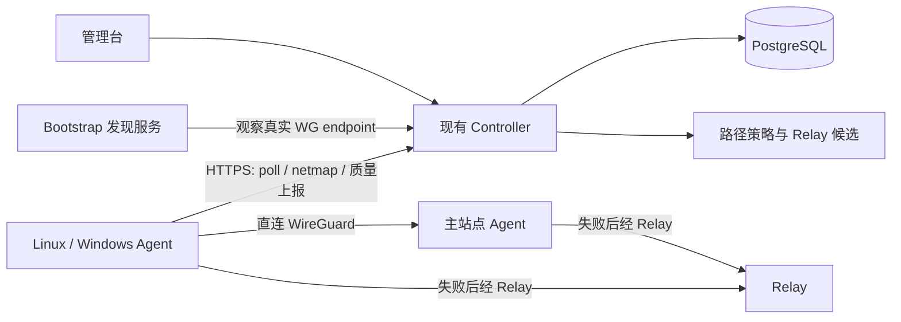
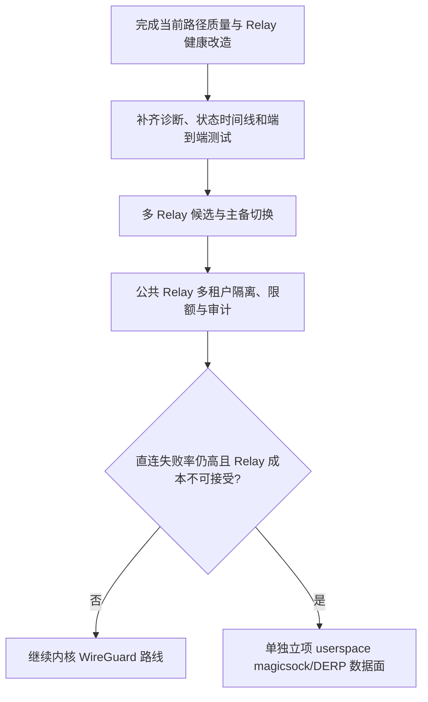

# SD-WAN 与 Tailcat 对比及改造路线

本文以当前工作区的 SD-WAN 实现为基线，并参考 [Tailcat](https://github.com/tailscale/tailcat) 的公开设计。本文是架构分析和改造路线，不代表已完成的功能清单，也不修改现有数据面协议。

## 1. 结论

当前 SD-WAN 的产品方向是正确的：它是有账户、设备、套餐、子网路由、主站点和管理台的组网产品；Tailcat 是一个不依赖控制平面的点对点连接工具。两者服务的场景不同，不能把 Tailcat 当作可直接嵌入的 SDK 或替代 Controller。

最合适的策略是保留当前 Controller 和内核 WireGuard 数据面，吸收 Tailcat 在路径诊断、Relay 候选、直连升级和用户体验上的思想。只有在将来确实需要大规模解决对称 NAT、移动网络和公共多租户 Relay 时，再评估引入 userspace WireGuard/magicsock 风格的数据面。



## 2. 架构对比

| 维度 | 当前 SD-WAN | Tailcat | 对当前项目的判断 |
|---|---|---|---|
| 产品边界 | 账户级 Overlay、设备管理、套餐、主站点和子网访问 | 临时连接、端口转发、文件和 SSH 工具 | 保留 SD-WAN 的控制平面，不迁移 Tailcat 的产品模型 |
| 身份与授权 | 邮箱、Admin Token、Device Token、Relay Token | 连接地址和密钥在带外交换 | 当前方案更适合 SaaS；可增加一次性入网码，不应改为地址即身份 |
| 数据面 | Linux/Windows Agent 配置内核 WireGuard | userspace WireGuard + magicsock + netstack | 当前方案部署简单、性能高；无法直接获得 magicsock 的 NAT 穿透能力 |
| Endpoint 获取 | Bootstrap WireGuard 观察内核 WG socket 的真实地址 | magicsock 自己拥有 UDP socket，使用 DERP 协调打洞 | Bootstrap 方案适合当前内核 WG；不要在 Agent 中重新加入临时 STUN 探测 |
| 直连与中继 | direct / auto / relay；单主站点、单活动自建 Relay | 先经 DERP 建立，再尽量升级 P2P；DERP 是最终兜底 | 当前应继续完善自动 fallback，再做多 Relay |
| 路径质量 | 已开始保存握手、收发字节、失败次数和本地切换状态 | 在同一 userspace 网络栈内观察连接与路径 | 这是当前最值得优先补强的部分 |
| Relay 模型 | 账户自建 WireGuard Hub Relay | 公共 DERP 网络，可共享但不转发三层 Overlay 路由 | 自建 Relay 可继续演进；公共 Relay 需要单独设计租户隔离 |
| 路由与子网 | Controller 下发 `AllowedIPs` 和批准的子网路由 | 默认不改系统路由和 DNS | 子网网关是 SD-WAN 的核心能力，应继续保留 |
| 客户端体验 | 服务/托盘程序、安装包、管理台 | 单命令、短地址、可诊断 | 可以借鉴“连接状态可见”和一次性邀请，不必复制 CLI 产品形态 |

Tailcat 的关键前提是它的 UDP socket、WireGuard 和 NAT 探测都在同一 userspace 数据面中；当前项目的 WireGuard socket 属于内核。因此，临时开一个 STUN socket 得到的公网 IP:port 不能代表实际 WireGuard endpoint。这个边界必须保持。

Tailcat 官方说明其通过 magicsock 建立直连，并以 DERP 作为 NAT 打洞协商通道与最终兜底中继；它也明确不提供 Tailscale 控制平面。[Tailcat README](https://github.com/tailscale/tailcat/blob/main/README.md)

## 3. 当前项目已具备的基础

当前工作区已有以下能力，可作为下一阶段的基座：

- Bootstrap 服务通过服务器端 WireGuard 观察真实 endpoint，而不是错误地猜测客户端公网地址。
- Controller 已有 `direct`、`auto`、`relay` 三种路径模式。
- Relay Agent 会同步 peer 并持续上报心跳。
- Agent 已保存原始 Netmap 和路径质量状态，在 `auto` 策略下可本地调整业务 `AllowedIPs` 的归属。
- 当前本地切换具有失败窗口、Relay 最短驻留和直连恢复窗口，可避免反复抖动。
- 管理台已能显示 Relay 心跳、接口状态、同步 peer 数量和账户级路径状态。

这些变化尚在工作区中，发布前应先完成回归测试和文档一致性检查。尤其是旧的客户端文档中仍有“无自动 Relay fallback”的表述，必须以实际发布行为为准统一更新。

## 4. 需要改变的地方

### P0：先把现有自动 fallback 做成可靠功能

目标不是增加更多策略，而是让管理员能明确知道“为什么走直连、为什么切 Relay、为什么无法切换”。

需要补充：

1. 定义统一的 Relay 健康状态：`healthy`、`degraded`、`unavailable`。健康判断至少结合 Agent 心跳、WireGuard 接口状态、最近 peer 同步时间和数据面收发变化；不能只看 Controller 收到一次 HTTP 心跳。
2. 当 Relay 不健康时，`auto` 模式必须停止把新路径切向该 Relay；已走 Relay 的客户端应有受控的回直连策略和清晰告警。
3. 为 Agent 增加 `diagnose` 的结构化输出，显示每个 peer 的直连/Relay endpoint、最新握手、收发字节、失败次数、当前业务 `AllowedIPs` 归属、最近切换原因和下一次允许切换时间。
4. 管理台展示路径时间线和原因，而不只显示 `current_path`。例如：`direct handshake timeout -> relay selected`。
5. 增加端到端测试：直连成功、直连中断后切 Relay、Relay 中断后保持或恢复直连、直连恢复后的驻留期回切、子网路由随路径归属变化。

完成标准：不看日志也能从管理台和 `diagnose` 判断一条链路是否可用、在用哪条路径、失败归因是什么。

### P1：从“单 Relay”演进为“候选 Relay 集合”

当前的单活动自建 Relay 是正确的 MVP，但它本身是单点。下一步应先改控制平面和状态模型，不急于更换 WireGuard 数据面。

建议新增的逻辑字段：

| 实体 | 建议字段/能力 | 作用 |
|---|---|---|
| Relay | `region`、`priority`、`capacity_state`、`health_state`、`last_data_plane_at` | 让 Controller 能筛选可用 Relay |
| 账户策略 | `relay_policy`、允许的 Relay 集合、首选区域 | 定义账户是否可自动切换和候选范围 |
| Netmap | `relay_candidates`、候选排序、策略 generation | Agent 可在本地快速选择已授权候选 |
| Agent 路径表 | 每个 peer x 每个候选 Relay 的质量数据 | 防止只知道“Relay 可用”，却不知道哪个 Relay 更好 |

选择顺序建议保持可解释，而不是一开始做复杂调度：

```text
健康状态 -> 用户指定优先级 -> 区域偏好 -> 最近成功收包时间 -> RTT -> 负载
```

切换应使用 generation 和最短驻留时间，确保多个 Agent 不会因 Controller 更新与本地判断相互覆盖。

完成标准：同一账户可以有主 Relay 和备用 Relay；主 Relay 不可用时，客户端在不重新注册、不手工改配置的情况下切到已下发的备用 Relay。

### P2：公共 Relay 的多租户设计

公共 Relay 不应等同于“把多个用户塞进一张大网”。推荐先采用共享宿主机、逻辑隔离账户的 WireGuard Hub 方案，仍由 Controller 决定每个账户能获得哪些 peer 和路由。

隔离规则：

- 每个设备只有自己的 WireGuard 密钥、Device Token 和账户 Overlay CIDR。
- Relay 同步 peer 时按 Relay 所属账户或被授权账户过滤，绝不把其他账户的 peer、公钥或 `AllowedIPs` 下发给客户端。
- 数据库为 Relay 授权显式建模，例如 `relay_account_bindings`，而不是以“全部账户可用”作为默认。
- Relay Agent 对每个账户维护独立 peer 集合；写入 WireGuard 前校验 AllowedIPs 必须属于该账户 Overlay CIDR 或该账户已批准子网。
- Controller、Relay Agent 和防火墙都要拒绝跨账户 CIDR；日志和计量按 `relay_id + user_id + device_id` 记录。
- 公共 Relay 的容量、带宽、连接数和版本兼容性需要限额与监控，不能沿用自建 Relay 的无限信任假设。

这一路线能够复用大部分当前 Controller、Netmap 和 WireGuard Hub 代码，但需要正式的授权绑定、CIDR 审计、限速和可观测性。它不是 DERP；其优点是能继续承载 Overlay 与主站点子网路由，代价是 Relay 需要处理实际三层流量。

### P3：是否引入 magicsock/DERP 风格数据面

这应作为独立的长期项目，而不是给现有 Agent 添加几个 STUN API。

要获得与 Tailcat 相近的 NAT 穿透效果，需要让同一个用户态组件拥有：WireGuard UDP socket、endpoint 探测、打洞协调、endpoint roaming、Relay 回退和路径选择。这意味着 Linux Agent 和 Windows Service 都要从“生成并应用内核 WireGuard 配置”逐步迁移为“用户态网络引擎或 sidecar”。

两条可选路线：

| 路线 | 适用时机 | 代价与结果 |
|---|---|---|
| 保持内核 WireGuard | 当前 1 到 2 个版本 | 继续依靠 Bootstrap endpoint 发现和多 Relay 兜底；性能、部署和子网功能最稳定 |
| 引入 userspace 网络引擎 | 有大量移动网络、CGNAT、对称 NAT 用户，且公共 Relay 成为核心产品 | 能做更强的 P2P 升级与 DERP-like fallback，但 Windows、路由、DNS、权限、性能和安全面都要重做 |

当前建议选择第一条。只有在监控数据证明“直连失败率和 Relay 流量成本”已经成为产品瓶颈时，再立项第二条。

## 5. 推荐执行顺序



建议下一次代码改动只做 P0：完善 Relay 健康状态、诊断输出、管理台路径原因和端到端测试。它的风险最低，且会为多 Relay 和公共 Relay 提供可靠的运行数据。

## 6. 明确不建议现在做的事

- 不要把 Tailcat 或 Tailscale 内部包直接作为当前 Controller/Agent 的运行时依赖；其依赖面和产品边界都不匹配。
- 不要在内核 WireGuard Agent 里恢复临时 STUN probing；它测到的不是内核 WireGuard socket 的 NAT 映射。
- 不要在尚无健康、审计和容量控制时直接开放公共 Relay 给所有账户。
- 不要让多个路径同时持有同一业务 `AllowedIPs`；这会造成 WireGuard 路由归属不确定，破坏 fallback 的可解释性。

## 7. 参考资料

- [Tailcat 项目主页](https://github.com/tailscale/tailcat)
- [Tailcat README：数据面、DERP 与 NAT traversal 说明](https://github.com/tailscale/tailcat/blob/main/README.md)
- [Tailcat 核心实现](https://github.com/tailscale/tailcat/blob/main/tailcat.go)
- [Tailcat disco 协议实现](https://github.com/tailscale/tailcat/blob/main/disco.go)
